<div align="center">

# hejiu45-oss

**单二进制、S3 兼容的对象存储服务，控制台内嵌，中英双语。**

一个约 6 MB 的可执行文件。无数据库、无 Redis、无运行时依赖。
用 SigV4 认证，用浏览器管理。

[](https://github.com/Hejiu-Web/hejiu45-oss/actions/workflows/ci.yml)
[](https://github.com/Hejiu-Web/hejiu45-oss/releases/latest)
[](LICENSE)
[](https://www.rust-lang.org)

[English](#english) · [中文](#中文) · [Changelog](CHANGELOG.md) · [部署指南](docs/DEPLOY-LINUX.md)

</div>

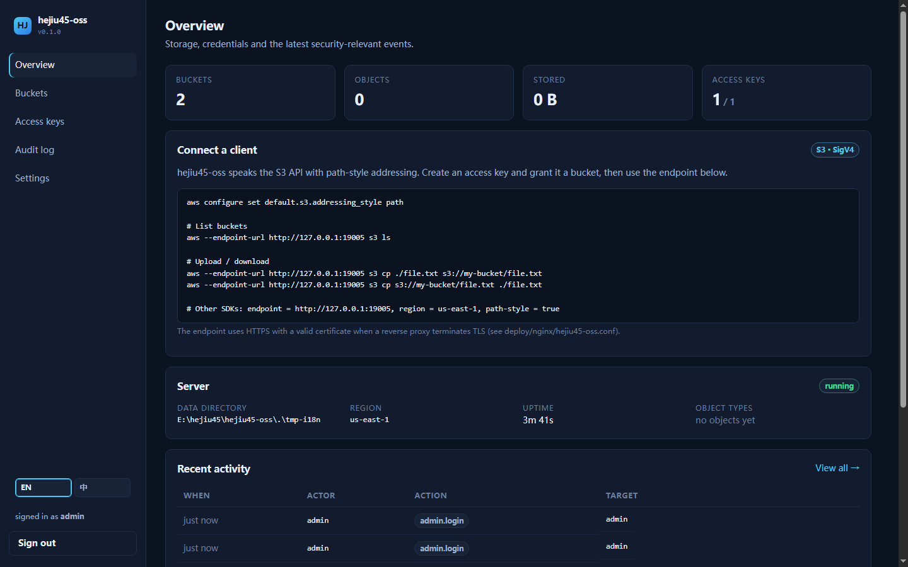

<details>
<summary>中文界面 / Chinese UI</summary>

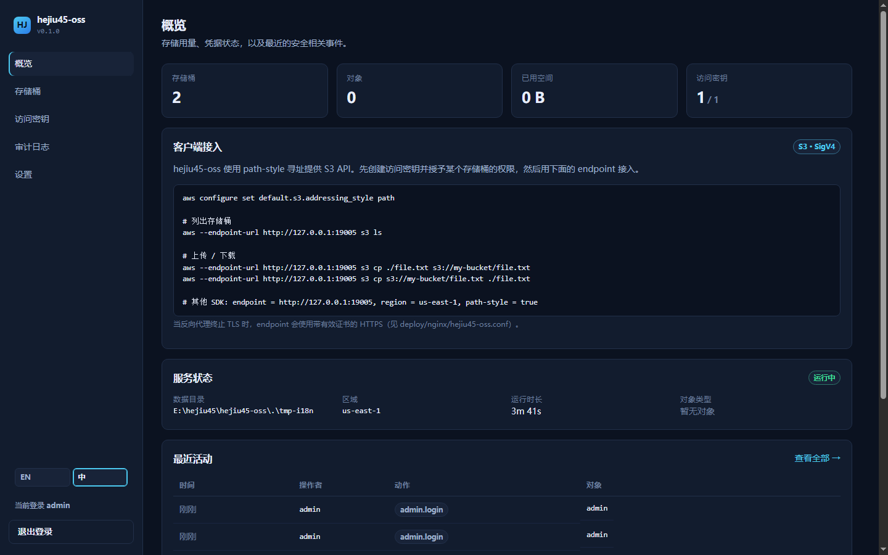

</details>

---

## 中文

### 这是什么

`hejiu45-oss` 是一个自托管的**对象存储服务**，对外提供 Amazon S3 API。
它是一个**静态链接的单二进制文件**，管理控制台在编译期被嵌入其中——
把一个文件拷到服务器，你就同时得到 S3 接口和一个网页控制台。

```text
┌──────────────────────────────────────────────────────────┐
│  hejiu45-oss  (single binary, ~6 MB)                     │
│                                                          │
│  GET  /            → 内嵌 Vue 3 控制台                    │
│  /api/*            → 管理 API（Cookie 会话）              │
│  /s3/*             → S3 数据面（SigV4 签名）              │
│                                                          │
│  ┌────────────┐  ┌──────────────┐  ┌──────────────────┐  │
│  │ redb       │  │ 文件系统      │  │ 认证              │  │
│  │ 元数据      │  │ 对象体        │  │ SigV4 · Argon2id │  │
│  │ (嵌入式)    │  │              │  │ AES-256-GCM      │  │
│  └────────────┘  └──────────────┘  └──────────────────┘  │
└──────────────────────────────────────────────────────────┘
```

### 与 MinIO 的差异

MinIO 证明了这个模式，随后又背离了它。`hejiu45-oss` 是同一思想的
**小而可审计**的实现，并在几处做了刻意的不同选择：

| 关注点 | hejiu45-oss 的做法 |
| :-- | :-- |
| **部署** | 单二进制。没有 Java、Python 或外部数据库。 |
| **控制台** | 编译进二进制——不存在需要单独托管的静态资源目录。 |
| **界面语言** | **中英双语**，右上角/侧栏一键切换，首次访问跟随浏览器语言，选择持久化。 |
| **S3 密钥** | Secret **信封加密**（HKDF 派生主密钥 + AES-256-GCM）后落库；数据库文件泄露也得不到可用密钥。 |
| **控制台会话** | 服务端会话、不透明 ID、`HttpOnly; Secure; SameSite=Strict`、可即时吊销。 |
| **默认最小权限** | 新访问密钥**默认无法访问任何桶**，必须逐桶授权，读与写分别控制。 |
| **路径安全** | 对象体按 key 的 SHA-256 存盘，`../../etc/passwd` 之类无法越界。 |
| **可审计** | 每个管理操作都记录操作者、目标与来源地址。 |

### 安全设计

两条**相互独立**的认证路径：控制台会话被盗也读不到对象字节；
S3 密钥泄露也登不进控制台。

| | 控制台 `/` | S3 接口 `/s3` |
| :-- | :-- | :-- |
| 凭证 | 用户名 + 密码 → 会话 Cookie | Access Key + Secret，**AWS SigV4** |
| 存储 | Argon2id（OWASP 参数，`salting`） | AES-256-GCM 信封加密 |
| 传输 | `HttpOnly; Secure; SameSite=Strict` | 对方法/路径/请求头/负载哈希签名 |
| 吊销 | 删会话或提升 generation | 停用或轮换密钥 |

已经实现并通过测试：

- **完整 SigV4 校验**，用 AWS 官方文档测试向量验证，并支持**预签名 URL**
  （`X-Amz-*` 查询参数认证）。
- **强制校验 `x-amz-content-sha256`**：边接收边比对流式哈希，声明的哈希真正生效。
- **15 分钟时钟偏移**与**预签名过期**强制校验；预签名 URL 仅允许 `GET`/`HEAD`，
  分享出去的链接无法用于写入。
- 下载响应带 `nosniff` 与 `sandbox` CSP，上传的 HTML 无法在你的域名下执行。
- **编译期嵌入前端**，不存在任何"按路径读文件"的入口。

威胁模型与漏洞上报见 [SECURITY.md](docs/SECURITY.md)。

### 快速开始

#### Linux（一条命令）

```bash
curl -fsSL https://raw.githubusercontent.com/Hejiu-Web/hejiu45-oss/main/install-linux.sh | sudo bash
```

完整步骤（手动部署、自定义路径、Nginx 反代、备份恢复、故障排查）见
[**Linux 部署指南**](docs/DEPLOY-LINUX.md)。

自动完成：下载静态二进制并校验 SHA-256 → 安装到 `/usr/local/bin` →
创建系统用户与 `/var/lib/hejiu45-oss` → 生成主密钥 → 写入加固的 systemd
单元 → 启动服务。初始管理员密码由服务在首次启动时打印一次。

#### Windows

只想本机跑起来看控制台，下载官方 exe 直接执行即可（**无需安装任何构建工具**）：

```powershell
.\hejiu45-oss.exe --data-dir .\data --listen 127.0.0.1:9000 --allow-insecure --admin-password "YourPass-123456"
```

然后浏览器打开 <http://127.0.0.1:9000>，用 `admin` / 该密码登录。
逐步说明（含从源码构建、装成服务）见下文
[**Windows 上启动**](#windows-上启动不装服务推荐先这样试)。

要开机自启、装成 Windows 服务，用管理员 PowerShell 一条命令：

```powershell
irm https://raw.githubusercontent.com/Hejiu-Web/hejiu45-oss/main/install-windows.ps1 | iex
```

安装到 `Program Files`、收紧数据目录 ACL，并通过固定版本的 WinSW 注册服务
（`-Mode task` 则改用计划任务，不引入额外组件）。

#### Windows 上启动（不装服务，推荐先这样试）

**方式 1：直接下载官方二进制（最快，无需任何构建工具）**

1. 打开 <https://github.com/Hejiu-Web/hejiu45-oss/releases/latest>，下载
   `hejiu45-oss-windows-amd64.exe`。
2. 放到一个固定目录，例如 `C:\hejiu45\`，并改名为 `hejiu45-oss.exe`。
3. 在该目录打开 PowerShell，启动：

   ```powershell
   .\hejiu45-oss.exe --data-dir .\data --listen 127.0.0.1:9000 --allow-insecure --admin-password "YourPass-123456"
   ```

4. 看到 `serving HTTP addr=127.0.0.1:9000` 后，浏览器打开
   <http://127.0.0.1:9000>，用 `admin` / 你设置的密码登录。

要点：

- `--data-dir .\data`：对象、元数据库、`master.key` 全部落在这里。
  **这个目录要备份**，丢了 `master.key` 就等于丢失所有 S3 密钥。
- `--allow-insecure` 只用于本机 HTTP 试跑。要让局域网或公网访问，
  必须走 TLS（见下文），否则会话 Cookie 不会带 `Secure`。
- 不传 `--admin-password` 会自动生成随机密码，**只在首次启动打印一次**，
  记得复制保存。
- 同一个数据目录只能有一个实例（进程级文件锁），重复启动会直接报错退出——
  这是保护，不是故障。要跑第二个实例，换 `--data-dir` 和 `--listen`。

**方式 2：从源码构建**

需要 Rust 1.85+、Node.js 20+，以及 C++ 生成工具 + NASM（`aws-lc-rs` 要编译 C/汇编）。

```powershell
git clone https://github.com/Hejiu-Web/hejiu45-oss
cd hejiu45-oss
cd frontend; npm ci; npm run build; cd ..    # 必须先构建前端：编译期嵌入
cargo build --release
.\target\release\hejiu45-oss.exe --data-dir .\data --listen 127.0.0.1:9000 --allow-insecure
```

> NASM 不在 `PATH` 时会报 `nasm not found`。装完把它加进 `PATH` 再重开终端。

**方式 3：装成 Windows 服务（开机自启）**

管理员 PowerShell 里跑安装脚本，它会下载并校验二进制、收紧数据目录 ACL、
通过固定版本的 WinSW 注册服务：

```powershell
irm https://raw.githubusercontent.com/Hejiu-Web/hejiu45-oss/main/install-windows.ps1 | iex
```

不想引入 WinSW 时用 `-Mode task` 改建计划任务。


#### 从源码构建

```bash
git clone https://github.com/Hejiu-Web/hejiu45-oss
cd hejiu45-oss
cd frontend && npm ci && npm run build && cd ..   # 必须先构建前端：编译期嵌入
cargo build --release
./target/release/hejiu45-oss --data-dir ./data --listen 127.0.0.1:9000 --allow-insecure
```

> **顺序不能颠倒**：`rust-embed` 在**编译期**读取 `frontend/dist/`。
> 没先构建前端时会嵌入一个占位页（并打印醒目警告），二进制能跑但控制台不可用。

浏览器打开 <http://127.0.0.1:9000> 登录。首次启动生成的密码只会打印一次。

### 控制台界面（中 / English）

控制台**内置中英双语**，无需任何额外依赖或语言包：

- **切换位置**：登录页在**右上角**；登录后在**左侧栏底部**（`EN | 中` 分段按钮）。
- **首次访问**跟随浏览器语言（`zh-*` → 中文，其余 → 英文）。
- **选择会记住**：存在 `localStorage` 的 `hj45.locale`，刷新、重启浏览器都保持。
- **完整覆盖**：导航、表格、按钮、提示、确认框、空状态、相对时间
  （"3 分钟前" / "3m ago"）、`<html lang>` 属性都会同步切换。
- 语言切换是**纯前端**行为，不会改变服务端的日志与审计记录（审计动作名保持英文，
  便于检索）。

截图（English / 中文）：

| | English | 中文 |
| :-- | :-- | :-- |
| 登录 | 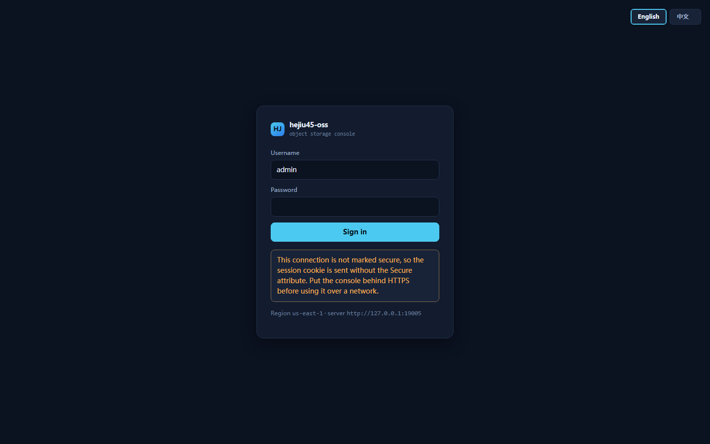 | 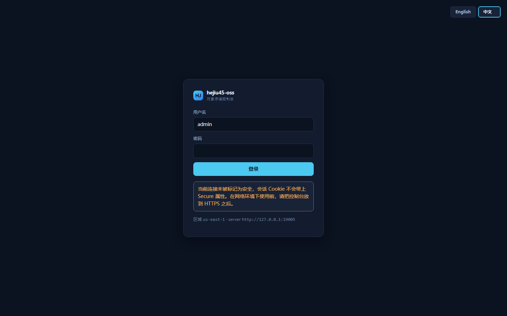 |
| 存储桶 | 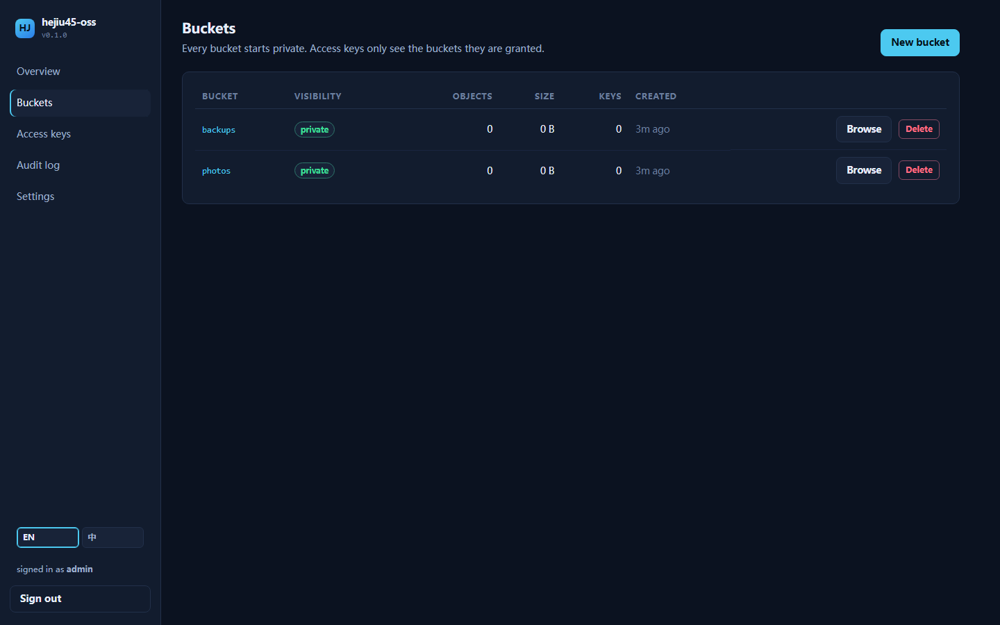 | 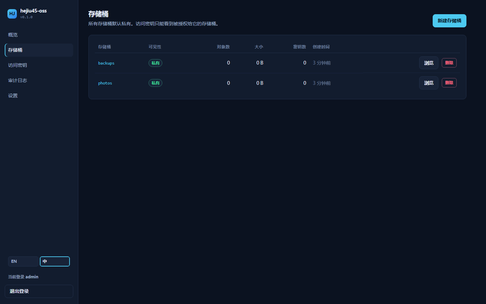 |
| 访问密钥 | 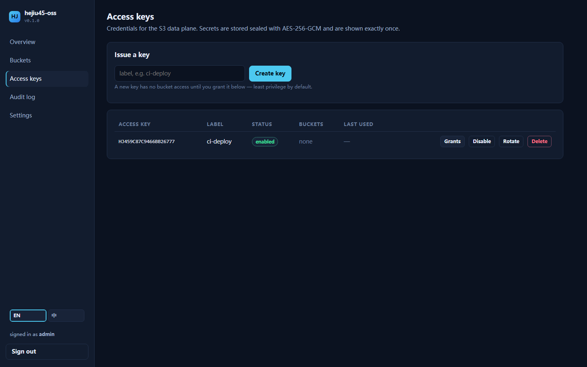 | 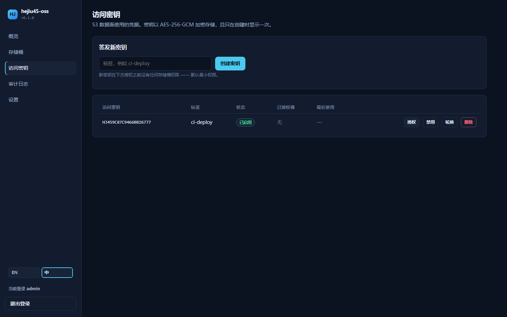 |
| 桶详情 | 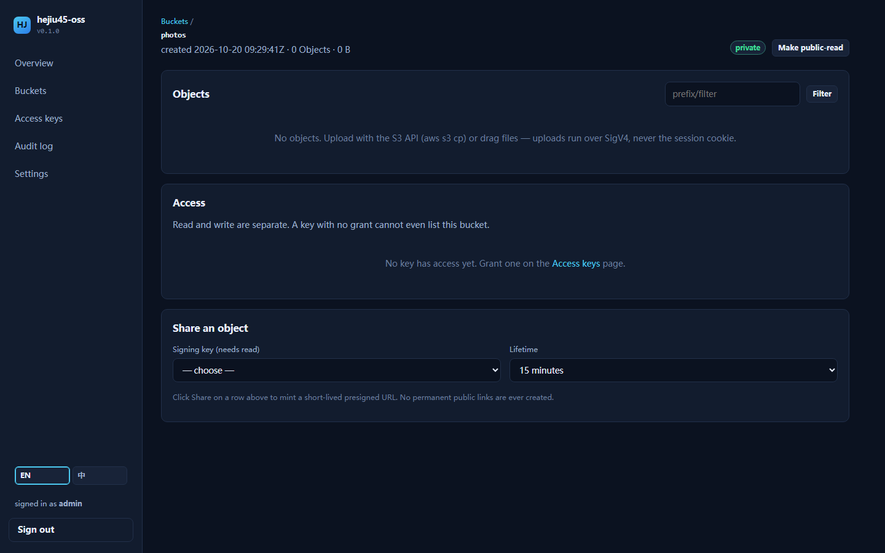 | 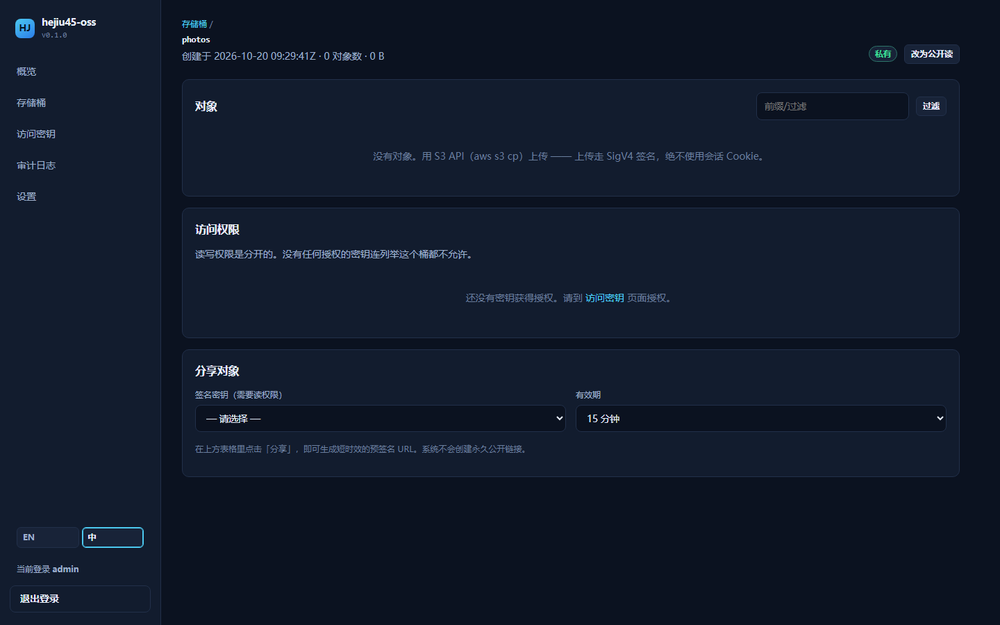 |
| 审计日志 | 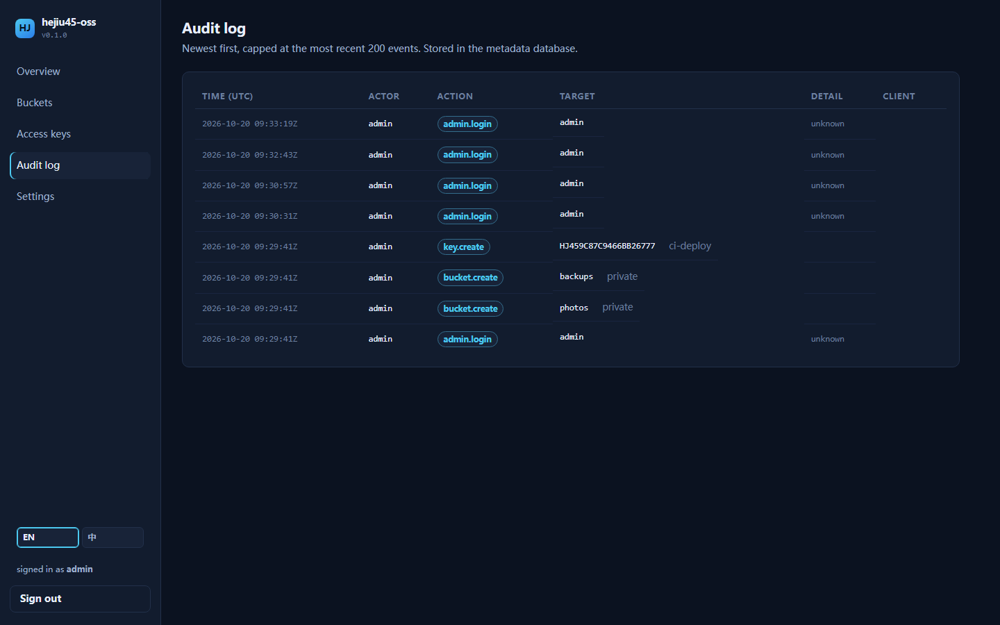 | 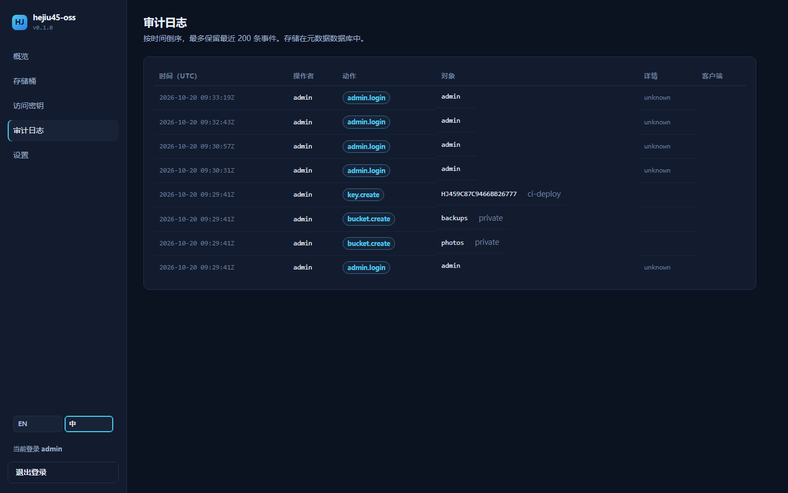 |
| 设置 | 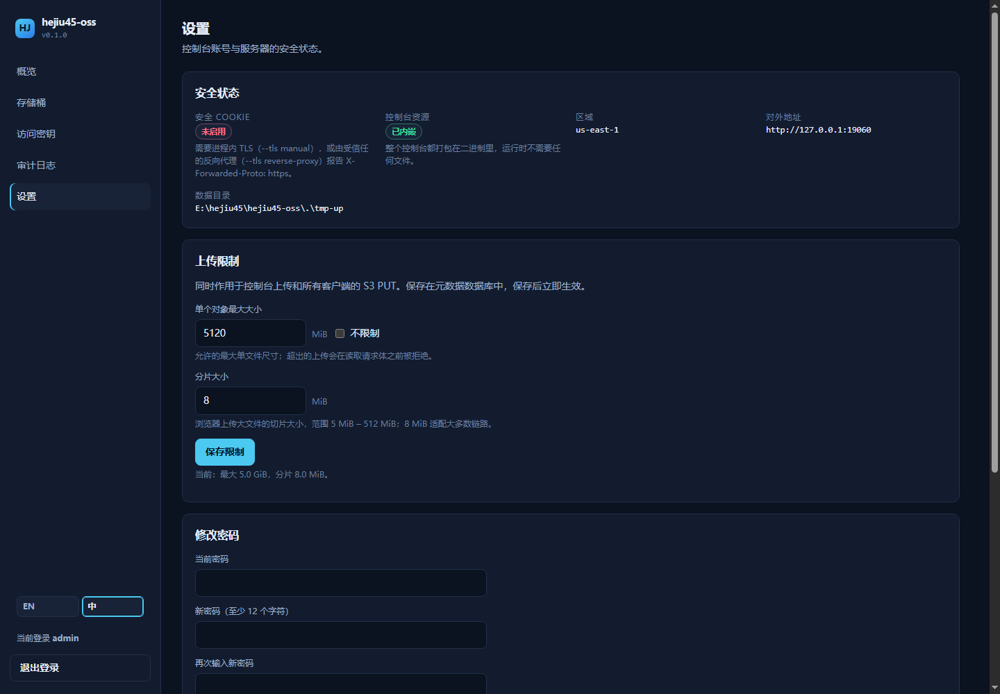 |  |

新增语言只需在 `frontend/src/i18n.js` 的 `messages` 里加一份文案；
`npm run check:i18n` 会校验各语言键集合一致、且代码中引用的键都存在，
该检查已挂在 `npm run build` 之前，漏翻会**直接构建失败**。

### 浏览器上传文件

控制台**可以直接上传文件**，不需要先创建访问密钥。进入任意存储桶，点「上传」即可：

| 能力 | 说明 |
| :-- | :-- |
| **拖拽上传** | 把文件或整个文件夹拖进上传区 |
| **多选 / 文件夹** | 「选择文件」支持多选，「选择文件夹」保留目录结构写入对象键 |
| **大文件** | 超过分片大小（默认 8 MiB）自动切片，**3 路并发**，可显示进度、速度、剩余时间，可随时取消 |
| **任意类型** | 图片、PDF、SVG、JSON、文本、压缩包、二进制等一律原样存储；浏览器上报的 `Content-Type` 被保留，预览时按真实类型渲染 |
| **两种模式** | ① 以管理员身份上传（默认，无需密钥）；② 用某把访问密钥的**预签名 PUT URL** 直传 |
| **配套操作** | 每行对象都有 预览 / 下载 / 分享（GET 预签名）/ 删除 |

**为什么默认不需要密钥**：控制台会话和 S3 的 SigV4 是两条隔离的认证路径。浏览器没有访问密钥，
所以控制台上传由服务端校验「**管理员会话 + 桶存在**」后代为写入，不再要求密钥授权——
否则用户为了传一个文件得先去创建密钥、再逐桶授权，体验过于绕。想严格走密钥路径时，
在上传区切到第二模式即可。

> 上传走的仍是**同一套落盘逻辑**（`Data::stage` → 原子替换 → 哈希），所以路径安全、
> 去重与限流规则和 S3 上传完全一致。

### 上传大小限制

**设置 → 上传限制**，管理员可直接在 Web 上修改：

- **单个对象最大大小**：默认 **5 GiB**，可勾选「不限制」。超出的上传在**读取请求体之前**
  就被拒绝（413），大文件在浏览器端也会先被拦下，不浪费带宽。
- **分片大小**：默认 **8 MiB**，范围 5 MiB – 512 MiB。浏览器上传大文件时按它切片。

这两个值**持久化在元数据数据库中**，保存后**立即生效**，重启不丢；同时作用于：

- 控制台上传（单次 PUT 与分片）
- **S3 客户端的 PUT**（aws-cli、boto3 等走的 `/s3` 路径）

启动参数 `--max-object-bytes` 仍可作为**兜底覆盖**（例如数据库里的值被误改时，
有 shell 权限的运维可以强制覆盖一次）。

### 客户端接入

S3 接口默认挂在 `/s3`（根路径留给控制台），使用 **path-style** 寻址。

```bash
export AWS_ACCESS_KEY_ID=HJ45QZ8AB3F1C2D4E5F6
export AWS_SECRET_ACCESS_KEY=...
ENDPOINT=http://127.0.0.1:9000/s3

aws configure set default.s3.addressing_style path
aws --endpoint-url $ENDPOINT s3 mb s3://photos
aws --endpoint-url $ENDPOINT s3 cp ./cat.jpg s3://photos/2026/cat.jpg
aws --endpoint-url $ENDPOINT s3 ls s3://photos/ --recursive
aws --endpoint-url $ENDPOINT s3 cp s3://photos/2026/cat.jpg ./cat.jpg
aws --endpoint-url $ENDPOINT s3 rm s3://photos/2026/cat.jpg --recursive
```

其他 SDK：设置 endpoint、region（默认 `us-east-1`）并强制 path-style 即可。
兼容 boto3、Go v2、Java、JS SDK，以及允许自定义 endpoint 的 `rclone` / `mc`。

### 支持的操作

| 类别 | 操作 |
| :-- | :-- |
| 服务 | `ListBuckets` |
| Bucket | `CreateBucket` · `HeadBucket` · `DeleteBucket` · `GetBucketLocation` |
| 对象 | `PutObject` · `GetObject`（支持 HTTP `Range`） · `HeadObject` · `DeleteObject` · `CopyObject` |
| 列举 | `ListObjects` (v1) · `ListObjectsV2`（前缀、分隔符、分页） |
| 批量 | `DeleteObjects` |
| 分片 | `CreateMultipartUpload` · `UploadPart` · `CompleteMultipartUpload` · `AbortMultipartUpload` · `ListMultipartUploads` |
| 认证 | SigV4 请求头 · 预签名 URL（`GET`/`HEAD`） |

**有意不实现**（返回明确的 `NotImplemented` 错误，而不是静默地行为错误）：
桶策略、ACL 文档（`?acl`）、版本控制、对象锁、生命周期、复制、事件通知、
`ListParts`。访问控制通过"每个密钥 × 每个桶"的授权表表达——模型更小，
且完全可审计。

### 生产部署（TLS）

服务只有在请求确实是 HTTPS 时才会给会话 Cookie 加 `Secure`，
因此**不要在网络上用明文 HTTP 运行控制台**。

#### 方案 A：反向代理（推荐）

把 TLS 交给 Nginx / Caddy，服务只监听回环：

```bash
hejiu45-oss --data-dir /var/lib/hejiu45-oss --listen 127.0.0.1:9000 \
  --tls reverse-proxy --public-url https://oss.example.com
```

- [`deploy/nginx/hejiu45-oss.conf`](deploy/nginx/hejiu45-oss.conf)：
  完整 Nginx 站点，含 Let's Encrypt 证书路径、`X-Forwarded-Proto`、
  大对象流式转发、安全响应头。
- [`deploy/caddy/Caddyfile`](deploy/caddy/Caddyfile)：三行搞定自动 HTTPS。

服务只信任来自代理的 `X-Forwarded-*`；`--tls reverse-proxy` 让它在代理
报告 `https` 时才给 Cookie 加 `Secure`。

#### 方案 B：进程内 TLS

```bash
hejiu45-oss --data-dir /var/lib/hejiu45-oss --listen 0.0.0.0:9443 \
  --tls manual --tls-cert /etc/letsencrypt/live/oss.example.com/fullchain.pem \
  --tls-key  /etc/letsencrypt/live/oss.example.com/privkey.pem \
  --public-url https://oss.example.com
```

证书会周期性从磁盘重载，`certbot renew` 之后无需重启服务。本地测试证书：

```bash
cargo run --features dev-tools --bin gen-cert -- cert.pem key.pem
```

### 配置

每个参数都有对应的环境变量，以 `hejiu45-oss --help` 为准。

| 参数 | 环境变量 | 默认值 | 说明 |
| :-- | :-- | :-- | :-- |
| `--listen` | `HEJIU45_OSS_LISTEN` | `127.0.0.1:9000` | 默认仅回环，建议前置代理 |
| `--data-dir` | `HEJIU45_OSS_DATA_DIR` | `./data` | 对象、元数据、主密钥 |
| `--tls` | `HEJIU45_OSS_TLS` | `off` | `off` · `manual` · `reverse-proxy` |
| `--tls-cert` / `--tls-key` | `HEJIU45_OSS_TLS_CERT` / `_KEY` | — | `manual` 模式必填 |
| `--public-url` | `HEJIU45_OSS_PUBLIC_URL` | — | 对外地址，预签名 URL 使用它 |
| `--s3-prefix` | `HEJIU45_OSS_S3_PREFIX` | `/s3` | 仅在独立域名/端口时才设为空 |
| `--region` | `HEJIU45_OSS_REGION` | `us-east-1` | 必须与客户端一致 |
| `--master-key` | `HEJIU45_OSS_MASTER_KEY` | 自动生成 | 32 字节 hex/base64 —— **务必备份** |
| `--admin-user` | `HEJIU45_OSS_ADMIN_USER` | `admin` | 仅首次启动生效 |
| `--admin-password` | `HEJIU45_OSS_ADMIN_PASSWORD` | 自动生成 | 仅首次启动生效 |
| `--session-hours` | `HEJIU45_OSS_SESSION_HOURS` | `12` | 控制台会话有效期 |
| `--max-object-bytes` | `HEJIU45_OSS_MAX_OBJECT_BYTES` | 不限 | 单次请求上限 |
| `--allow-insecure` | `HEJIU45_OSS_ALLOW_INSECURE` | `false` | 允许在非回环地址上跑明文 HTTP |

离线维护：

```bash
# 元数据一致性备份
hejiu45-oss --data-dir /var/lib/hejiu45-oss --backup-to /backup/meta.redb

# 恢复到空数据目录
hejiu45-oss --data-dir /var/lib/hejiu45-oss-restored --restore-from /backup/meta.redb

# 为 CI 发放密钥（无需打开控制台）
hejiu45-oss --data-dir /var/lib/hejiu45-oss --init-access-key ci --init-bucket artifacts
```

备份 `objects/`、元数据文件，**以及 `master.key`**（或 `HEJIU45_OSS_MASTER_KEY`
的值）。丢失主密钥意味着所有已发放的 S3 密钥都必须重新签发。

### 测试

```bash
cargo test                                   # 63 个单元测试 + 7 个 HTTP 集成测试
./scripts/e2e-awscli.ps1 -Endpoint http://127.0.0.1:9000/s3   # 21 项真实 AWS CLI 检查
./scripts/e2e-s3.ps1    -Base http://127.0.0.1:9000           # 23 项（PowerShell，手写签名）
```

`tests/s3_http.rs` 会在回环端口启动**真实路由**，用一份**独立实现**的 SigV4
签名器发请求，因此路由、中间件、验签、存储全链路都能在任意平台上用
`cargo test` 覆盖。AWS CLI 套件单独存在，因为它验证的是与真实 SDK 的兼容性——
`aws-chunked` 分块与并发分片这两个 bug 正是它发现的。

端到端脚本用真实 SigV4 签名发起请求，并覆盖关键的反向用例：
未签名请求、篡改签名、`x-amz-content-sha256` 不匹配、region 错误。

### 项目结构

```text
src/
  config.rs      命令行/环境变量
  error.rs       AWS XML 错误 + 控制台 JSON 错误
  crypto.rs      CSPRNG、HKDF/AES-GCM 信封加密、Argon2id
  meta.rs        redb 元数据引擎
  data.rs        文件系统对象体、原子替换、内容嗅探
  auth/          SigV4 校验、ACL、预签名
  s3/            S3 协议处理
  admin/         控制台 API 与会话
  web.rs         内嵌控制台服务
  server.rs      路由、TLS、优雅关闭
frontend/        Vue 3 + Vite 控制台（纯 JavaScript）
deploy/          Nginx / Caddy 反向代理配置
docs/            安全模型、API 说明、截图
```

### 许可证

MIT，见 [LICENSE](LICENSE)。

---

## English

### What it is

`hejiu45-oss` is a self-hosted object storage server that speaks the Amazon S3
API. It is a **single statically linked binary** with the admin console
compiled in — copy one file to a server and you have an S3 endpoint plus a web
UI.

### Why another S3 server

MinIO proved the model and then moved away from it. `hejiu45-oss` is a small,
auditable implementation of the same idea with deliberate differences:

| Concern | How hejiu45-oss handles it |
| :-- | :-- |
| **Deployment** | One binary. No Java, no Python, no external database. |
| **Console** | Compiled into the binary — nothing to serve from disk. |
| **Languages** | **Bilingual (English / 中文)**, one click to switch; follows the browser on first visit and remembers the choice. |
| **S3 credentials** | Secrets are **envelope-encrypted** (AES-256-GCM under an HKDF-derived master key). A stolen database file yields no usable keys. |
| **Console sessions** | Server-side, opaque IDs, `HttpOnly; Secure; SameSite=Strict`, instant revocation. |
| **Least privilege** | A new access key can reach **nothing** until granted specific buckets, with read and write tracked separately. |
| **Path safety** | Bodies are stored under the SHA-256 of the key, so `../../etc/passwd` style keys cannot escape the data directory. |
| **Auditability** | Every administrative action records actor, target and client address. |

### Security posture

Two independent authentication paths: a stolen console session cannot read
object bytes, and a leaked S3 key cannot log in.

| | Console (`/`) | S3 API (`/s3`) |
| :-- | :-- | :-- |
| Credential | Username + password → session cookie | Access key + secret, **AWS SigV4** |
| At rest | Argon2id (OWASP parameters via `salting`) | Sealed with AES-256-GCM |
| Transport | `HttpOnly; Secure; SameSite=Strict` | Signature over method, path, headers, payload hash |
| Revocation | Delete the session or bump the generation | Disable or rotate the key |

Implemented and tested:

- **Full SigV4 verification**, validated against the AWS documentation vectors,
  including **presigned URLs** (`X-Amz-*` query authentication).
- **`x-amz-content-sha256` enforcement** — the declared hash is compared against
  the stream as it arrives, so the signed hash is genuinely bound.
- **15-minute clock skew** and **presigned expiry** enforced; presigned URLs are
  limited to `GET`/`HEAD`, so a shared link can never originate a write.
- Downloads carry `nosniff` and a `sandbox` CSP, so an uploaded HTML file cannot
  execute on your origin.
- **Compile-time console embedding**: no code path serves arbitrary files.

See [SECURITY.md](docs/SECURITY.md) for the threat model and reporting process.

### Quick start

```bash
# Linux — installs a hardened systemd service
curl -fsSL https://raw.githubusercontent.com/Hejiu-Web/hejiu45-oss/main/install-linux.sh | sudo bash

# Windows — elevated PowerShell; installs a WinSW-backed service
irm https://raw.githubusercontent.com/Hejiu-Web/hejiu45-oss/main/install-windows.ps1 | iex
```

Just want to try it on Windows? Download the release `.exe` and run it — no
toolchain required:

```powershell
.\hejiu45-oss.exe --data-dir .\data --listen 127.0.0.1:9000 --allow-insecure --admin-password "YourPass-123456"
```

Then open <http://127.0.0.1:9000> and sign in as `admin`. Step-by-step notes
(building from source, installing a service) are in
[**Start it on Windows**](#start-it-on-windows-without-installing-a-service).

# From source (build the console FIRST: it is embedded at compile time)
cd frontend && npm ci && npm run build && cd ..
cargo build --release
./target/release/hejiu45-oss --data-dir ./data --listen 127.0.0.1:9000 --allow-insecure
```

Open <http://127.0.0.1:9000>; the initial admin password is printed once on
first start.

### Start it on Windows (without installing a service)

**Option 1: run the released binary (no toolchain needed)**

1. Download `hejiu45-oss-windows-amd64.exe` from
   <https://github.com/Hejiu-Web/hejiu45-oss/releases/latest>.
2. Put it in a stable folder such as `C:\hejiu45\` and rename it to
   `hejiu45-oss.exe`.
3. In PowerShell, from that folder:

   ```powershell
   .\hejiu45-oss.exe --data-dir .\data --listen 127.0.0.1:9000 --allow-insecure --admin-password "YourPass-123456"
   ```

4. Once it logs `serving HTTP addr=127.0.0.1:9000`, open
   <http://127.0.0.1:9000> and sign in as `admin` with that password.

Notes:

- `--data-dir .\data` holds objects, the metadata database and `master.key`.
  **Back that folder up**: losing `master.key` makes every stored S3 secret
  unreadable.
- `--allow-insecure` is for a local HTTP trial only. Anything reachable from
  the network must use TLS, otherwise the session cookie is not marked
  `Secure`.
- Omit `--admin-password` to have a random one generated and printed **once**.
- One data directory serves one process at a time (an OS file lock); a second
  instance exits with an error. That is a guard, not a fault. Use separate
  `--data-dir` and `--listen` values for a second instance.

**Option 2: build from source** (Rust 1.85+, Node.js 20+, plus MSVC build tools
and NASM because `aws-lc-rs` compiles C and assembly):

```powershell
git clone https://github.com/Hejiu-Web/hejiu45-oss
cd hejiu45-oss
cd frontend; npm ci; npm run build; cd ..
cargo build --release
.\target\release\hejiu45-oss.exe --data-dir .\data --listen 127.0.0.1:9000 --allow-insecure
```

Building the console first is mandatory: `rust-embed` reads `frontend/dist/`
at compile time. If NASM is missing you get `nasm not found`; add it to `PATH`
and reopen the terminal.

**Option 3: install as a service (starts on boot)** — elevated PowerShell:

```powershell
irm https://raw.githubusercontent.com/Hejiu-Web/hejiu45-oss/main/install-windows.ps1 | iex
```

The script verifies the download, tightens the data-directory ACL and registers
a WinSW-backed service (`-Mode task` uses a scheduled task instead).

### Console language (English / 中文)

The console ships **bilingual** — no separate language pack, no extra request:

- **Where to switch**: top-right on the login page; bottom of the sidebar once
  signed in (an `EN | 中` segmented control).
- **First visit** follows the browser (`zh-*` → Chinese, everything else →
  English).
- **The choice sticks**: stored in `localStorage` under `hj45.locale`, so it
  survives reloads and restarts.
- **Fully covered**: navigation, tables, buttons, hints, confirm dialogs, empty
  states, relative times ("3m ago" / "3 分钟前") and the `<html lang>` attribute.
- Switching is **client-side only**; server logs and audit actions stay in
  English so they remain greppable.

| | English | 中文 |
| :-- | :-- | :-- |
| Login |  |  |
| Buckets |  |  |
| Bucket detail |  |  |

Adding a language means adding one entry to `messages` in
`frontend/src/i18n.js`. `npm run check:i18n` verifies that every language has
the same keys and that every key referenced in the source exists; it runs as
part of `npm run build`, so a missing translation fails the build.

### Connect a client

The S3 API lives under `/s3` by default (the console owns `/`) and uses
**path-style addressing**.

```bash
aws configure set default.s3.addressing_style path
export AWS_ACCESS_KEY_ID=HJ45QZ8AB3F1C2D4E5F6 AWS_SECRET_ACCESS_KEY=...
ENDPOINT=http://127.0.0.1:9000/s3

aws --endpoint-url $ENDPOINT s3 mb s3://photos
aws --endpoint-url $ENDPOINT s3 cp ./cat.jpg s3://photos/2026/cat.jpg
aws --endpoint-url $ENDPOINT s3 ls s3://photos/ --recursive
```

Works with the AWS CLI, boto3, Go v2, Java and JS SDKs: set the endpoint,
region (`us-east-1` by default) and force path-style.

### Browser uploads

The console uploads files **directly — no access key required**. Open a bucket
and click Upload:

| Capability | Detail |
| :-- | :-- |
| **Drag and drop** | Drop files or whole folders onto the upload panel |
| **Multi-select / folders** | "Choose files" accepts many at once; "Choose folder" keeps the directory structure in the object key |
| **Large files** | Anything over the part size (8 MiB default) is chunked automatically, **3 parts in flight**, with progress, speed, ETA and cancel |
| **Any file type** | Images, PDF, SVG, JSON, text, archives, binaries — stored byte-for-byte. The browser's `Content-Type` is kept, so previews render correctly |
| **Two modes** | ① as the signed-in admin (default, no key); ② with an access key's **presigned PUT URL** |
| **Around it** | Every row has Preview / Download / Share (presigned GET) / Delete |

**Why no key by default**: console auth (cookie session) and S3 auth (SigV4) are
deliberately isolated, and a browser holds no access key. The server therefore
performs the write after checking *admin session + bucket exists*. Demanding a
key and a per-bucket grant just to drag a file in would be disproportionate;
switch to the second mode when the strict grant-scoped path matters.

> Writes go through the **same storage engine** (`Data::stage` → atomic replace
> → hashing), so path safety, hashing and limits behave exactly as for S3.

### Upload limits

**Settings → Upload limits**, editable in the console:

- **Maximum object size** — 5 GiB by default, or tick "Unlimited". Oversized
  uploads are rejected with 413 *before the body is read*, and the browser
  refuses them locally so no bandwidth is wasted.
- **Multipart part size** — 8 MiB by default, 5 MiB – 512 MiB.

Both are **persisted in the metadata database**, take effect **immediately**, and
apply to **console uploads and S3 PUTs alike** (aws-cli, boto3, …).

The `--max-object-bytes` flag remains as an override for operators with shell
access (e.g. to correct a bad stored value).

### Supported operations

`ListBuckets`, `CreateBucket`, `HeadBucket`, `DeleteBucket`,
`GetBucketLocation`, `PutObject`, `GetObject` (with HTTP `Range`),
`HeadObject`, `DeleteObject`, `CopyObject`, `ListObjects` v1 and v2 (prefix,
delimiter, pagination), `DeleteObjects`, and the full multipart set
(create/upload/complete/abort/list). Auth: SigV4 header plus presigned URLs.

**Deliberately not implemented** (an explicit `NotImplemented` error rather
than silent misbehaviour): bucket policies, ACL documents, versioning, object
lock, lifecycle, replication, notifications, `ListParts`. Access control is a
per-key bucket grant table — a smaller model that is fully auditable.

### Production (TLS)

The server only marks the session cookie `Secure` when the request is actually
HTTPS, so **never run the console over plain HTTP on a network**.

```bash
# Reverse proxy (recommended): Nginx/Caddy terminates TLS
hejiu45-oss --data-dir /var/lib/hejiu45-oss --listen 127.0.0.1:9000 \
  --tls reverse-proxy --public-url https://oss.example.com

# Or TLS in-process with a certbot certificate (reloaded from disk periodically)
hejiu45-oss --data-dir /var/lib/hejiu45-oss --listen 0.0.0.0:9443 \
  --tls manual --tls-cert fullchain.pem --tls-key privkey.pem \
  --public-url https://oss.example.com
```

Ready-made configs: [`deploy/nginx/hejiu45-oss.conf`](deploy/nginx/hejiu45-oss.conf)
and [`deploy/caddy/Caddyfile`](deploy/caddy/Caddyfile).

### Configuration

Every flag has an environment variable; `hejiu45-oss --help` is authoritative.
`--listen` defaults to `127.0.0.1:9000`, `--data-dir` to `./data`, `--region` to
`us-east-1`, and `--s3-prefix` to `/s3`. The master key (32 bytes, hex or
base64) comes from `--master-key` / `HEJIU45_OSS_MASTER_KEY` or is generated into
the data directory — **back it up**, or stored S3 secrets become unreadable.

Offline maintenance:

```bash
hejiu45-oss --data-dir DIR --backup-to /backup/meta.redb    # consistent metadata copy
hejiu45-oss --data-dir DIR --restore-from /backup/meta.redb # into an empty directory
hejiu45-oss --data-dir DIR --init-access-key ci --init-bucket artifacts
```

### Testing

```bash
cargo test                                   # 63 unit + 7 HTTP integration tests
./scripts/e2e-awscli.ps1 -Endpoint http://127.0.0.1:9000/s3   # 21 checks, real AWS CLI
./scripts/e2e-s3.ps1    -Base http://127.0.0.1:9000           # 23 checks (PowerShell, hand-signed)
```

`tests/s3_http.rs` starts the real router on a loopback port and signs requests
with an **independent** SigV4 implementation, so routing, middleware,
verification and storage are all exercised on every platform by `cargo test`.
The AWS CLI suite stays separate because it proves compatibility with a real
SDK — it is what caught the `aws-chunked` framing and concurrent-part bugs.

The e2e script signs real SigV4 requests and covers the negative cases that
matter: unsigned requests, tampered signatures, a mismatched
`x-amz-content-sha256`, and a wrong region.

### Project layout

```text
src/config.rs   CLI/env          src/auth/    SigV4, ACLs, presigning
src/crypto.rs   envelope crypto  src/s3/      S3 protocol handlers
src/meta.rs     redb metadata    src/admin/   console API + sessions
src/data.rs     bodies, atomic   src/web.rs   embedded console
frontend/       Vue 3 (plain JS) deploy/      Nginx / Caddy configs
```

### License

MIT. See [LICENSE](LICENSE).


